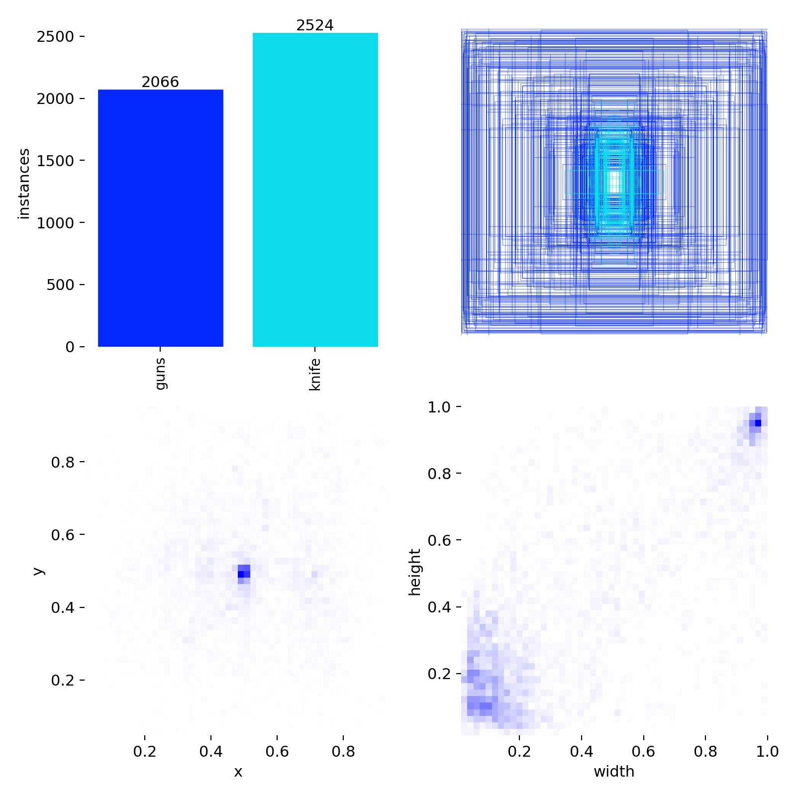
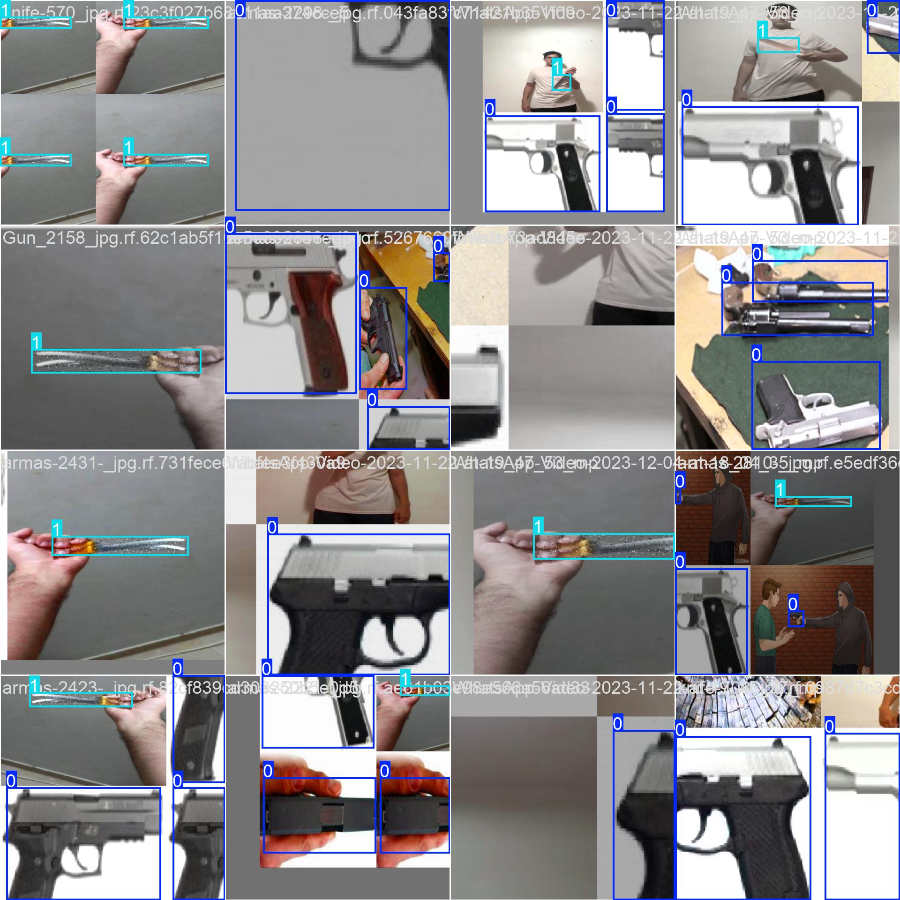
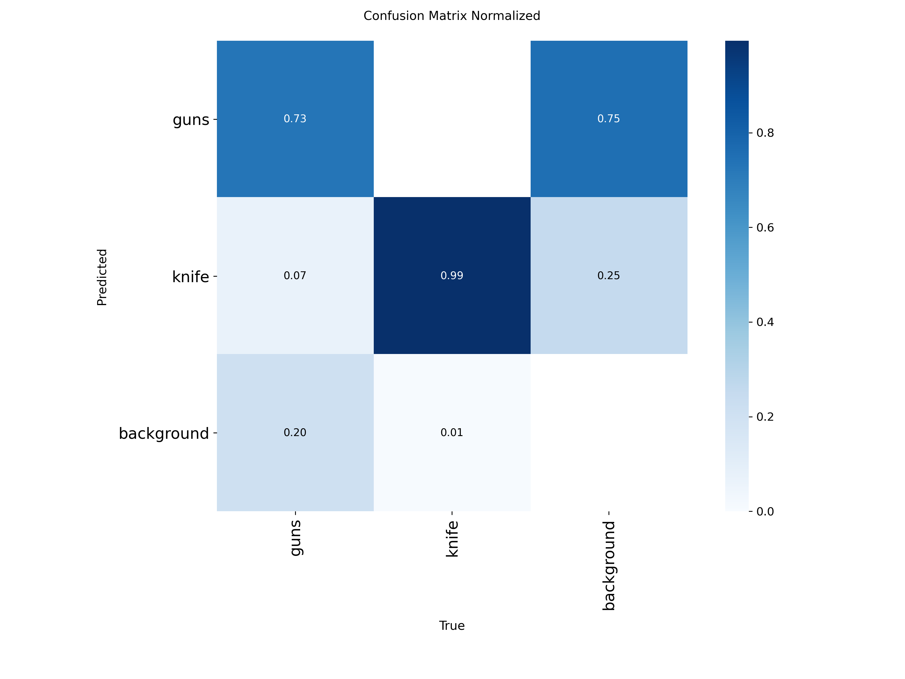
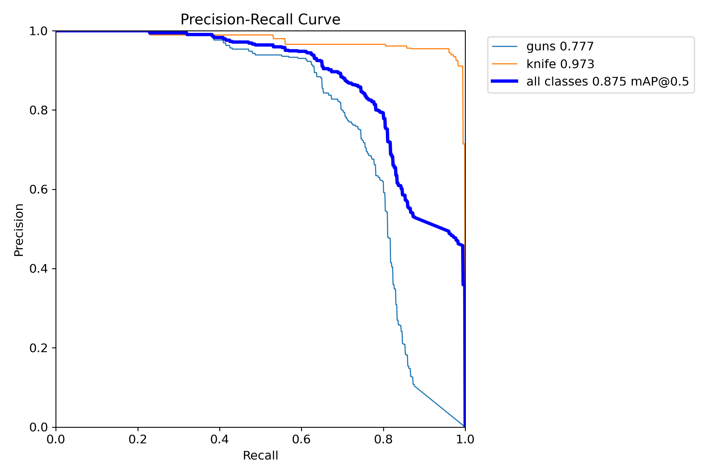
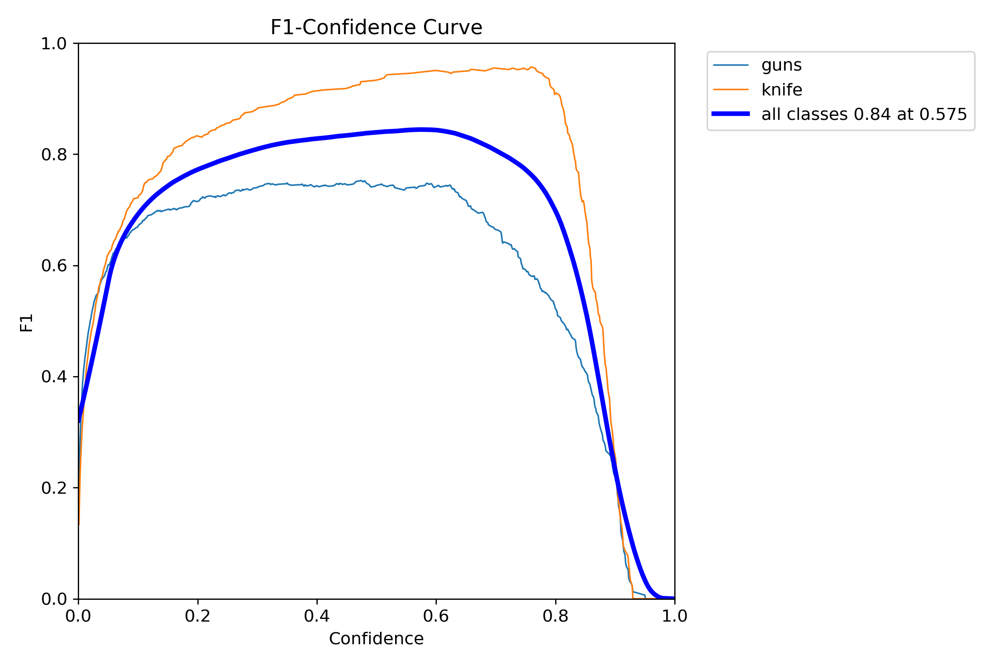
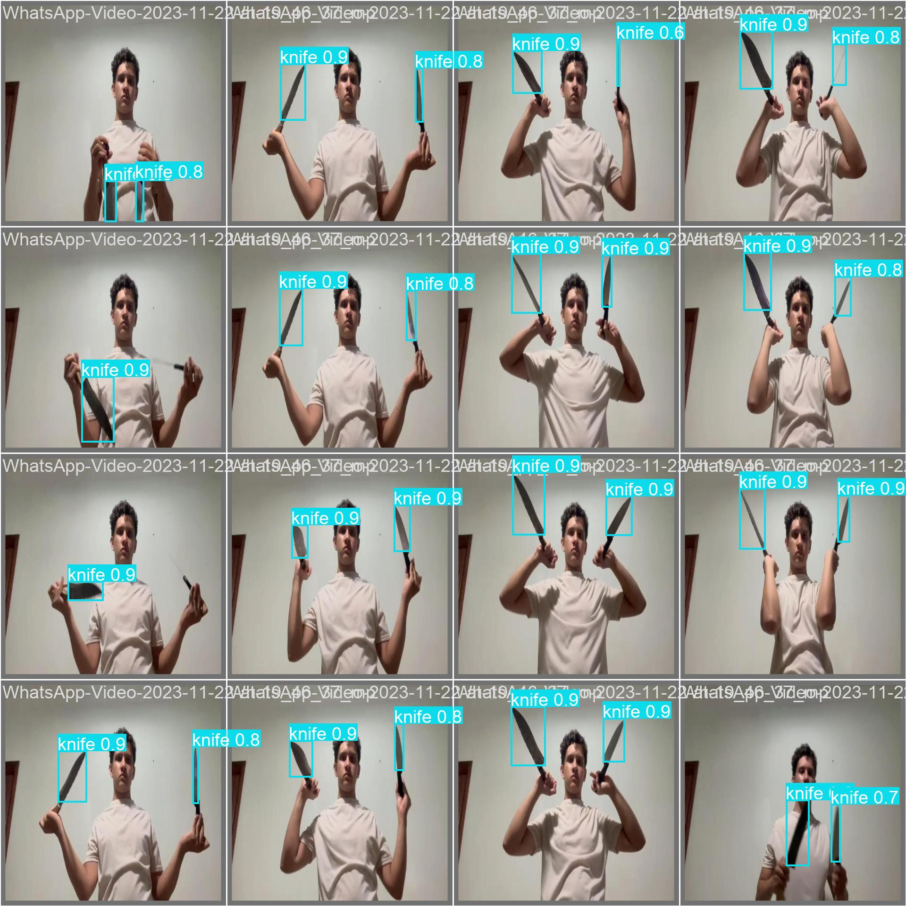

# Weapon Detector — Detekcja broni na zdjęciach

Projekt zaliczeniowy z przedmiotu **Głębokie Uczenie**. Celem jest zbudowanie detektora broni palnej (`guns`) oraz noży (`knife`) na rzeczywistych zdjęciach z wykorzystaniem modelu **YOLOv8n** (fine-tuning pretrenowanych wag).

---

## Spis treści

1. [Opis zadania](#opis-zadania)
2. [Dataset](#dataset)
3. [Model i trening](#model-i-trening)
4. [Wyniki ewaluacji](#wyniki-ewaluacji)
5. [Inferencja na nowych zdjęciach](#inferencja-na-nowych-zdjęciach)
6. [Logi treningowe](#logi-treningowe)
7. [Struktura projektu](#struktura-projektu)
8. [Jak uruchomić](#jak-uruchomić)
9. [Podsumowanie](#podsumowanie)

---

## Opis zadania

Zbudować detektor broni i noży na zdjęciach, który potrafi:

1. **Wykrywać broń** na zdjęciach (bounding box wokół obiektu).
2. **Odróżniać broń od nie-broni** (np. autobus, osoba, inne obiekty).
3. **Działać na nowych, niewidzianych zdjęciach** (zdolność generalizacji).
4. **Pracować na zdjęciach rzeczywistych** — z tłem, innymi obiektami, w naturalnym kontekście.


## Dataset

### Źródło

- **Nazwa:** Weapon-2
- **Platforma:** Roboflow Universe
- **Link do datasetu:** <https://universe.roboflow.com/weaponsmodel/weapon-2-bm52f>
- **Link wersjonowany (użyty w projekcie):** <https://universe.roboflow.com/joao-assalim-xmovq/weapon-2/dataset/2>
- **Licencja:** CC BY 4.0
- **Format anotacji:** YOLO (bounding boxes — txt per obraz)

### Klasy (2)

| ID | Nazwa    | Liczba obiektów |
|----|----------|-----------------|
| 0  | `guns`   | 2 066           |
| 1  | `knife`  | 2 524           |

### Podział zbioru

| Split | Liczba obrazów | Liczba etykiet |
|-------|----------------|----------------|
| Train | 3 839          | 3 839          |
| Test/Val | 259         | 259            |

### Konfiguracja (`data/data.yaml`)

```yaml
train: train/images
val: test/images
test: test/images

nc: 2
names: [ 'guns', 'knife' ]

roboflow:
  workspace: joao-assalim-xmovq
  project: weapon-2
  version: 2
  license: CC BY 4.0
  url: https://universe.roboflow.com/joao-assalim-xmovq/weapon-2/dataset/2
```

### Screenshot 1 — Konfiguracja datasetu i przykładowe anotacje

Widoczna struktura katalogów, plik `data.yaml` oraz przykładowe obrazy treningowe z bounding boxami.


### Dodatkowy screenshot — Rozkład klas i bounding boxów

Rozkład liczebności klas w zbiorze treningowym, rozmieszczenie bounding boxów oraz ich rozmiary (wygenerowany automatycznie przez YOLO).



### Dodatkowy screenshot — Przykładowy batch treningowy

Przykład tego, jak YOLO "widzi" dane wejściowe po augmentacji (mosaic, flip, HSV).



---

## Model i trening

### Model bazowy

- **YOLOv8n** (nano) — najlżejszy wariant YOLOv8 (ok. 6.2 MB po stripingu).
- Startowe wagi: `yolov8n.pt` (pretrenowane na COCO).
- Fine-tuning na własnym datasecie Weapon-2.

### Hiperparametry treningu

| Parametr       | Wartość |
|----------------|---------|
| Epoki          | **25** (powyżej wymaganych 20) |
| Batch size     | 16 |
| Image size     | 640 × 640 |
| Optimizer      | auto (SGD) |
| LR (lr0)       | 0.01 |
| Momentum       | 0.937 |
| Weight decay   | 0.0005 |
| Patience (early stop) | 10 |
| Augmentacja    | mosaic, flip LR, HSV, randaugment |
| Device         | auto (GPU jeśli dostępne) |

### Czas treningu

- **25 epok ≈ 0.316 h (≈ 19 minut)** na jednostce treningowej.
- Tracking eksperymentu: **MLflow** (`runs/mlflow/...`).

### Screenshot 2 — Logi treningowe i krzywe metryk

Krzywe loss (box/cls/dfl) oraz metryk (precision, recall, mAP50, mAP50-95) w każdej epoce. Widoczny jest wyraźny, monotoniczny spadek wszystkich komponentów loss oraz wzrost metryk jakości detekcji.


---

## Wyniki ewaluacji

Ewaluacja najlepszego modelu (`best.pt`) na zbiorze walidacyjnym (259 obrazów, 481 obiektów).

### Metryki globalne

| Metryka      | Wartość   |
|--------------|-----------|
| **mAP50**    | **0.8750** |
| **mAP50-95** | **0.6903** |
| Precision    | 0.887     |
| Recall       | 0.822     |

### Metryki per klasa

| Klasa   | Images | Instances | Precision | Recall | mAP50   | mAP50-95 |
|---------|--------|-----------|-----------|--------|---------|----------|
| `guns`  | 161    | 306       | 0.868     | 0.650  | 0.776   | 0.588    |
| `knife` | 93     | 175       | 0.905     | 0.994  | **0.974** | **0.793** |

**Obserwacja:** Klasa `knife` została opanowana bardzo dobrze (mAP50 ≈ 0.97), natomiast `guns` jest trudniejsza — recall 0.65 oznacza, że model pomija ok. 35 % pistoletów. Może to wynikać z większej różnorodności kształtów/pozycji broni palnej oraz mniejszej liczby instancji (2 066 vs 2 524).

### Screenshot 3 — Wyniki ewaluacji

Porównanie metryk per klasa oraz confusion matrix.


### Dodatkowy screenshot — Confusion Matrix (znormalizowana)

Znormalizowana macierz pomyłek — dobrze widać, że klasa `knife` jest prawie idealnie rozpoznawana, a pistolety są częściej mylone z tłem niż z nożami.



### Dodatkowy screenshot — Krzywa Precision-Recall



### Dodatkowy screenshot — Krzywa F1

Pomaga dobrać optymalny próg confidence.



### Dodatkowy screenshot — Predykcje na batchu walidacyjnym

Wizualne porównanie predykcji modelu z ground truth na realnym batchu walidacyjnym.



---

## Inferencja na nowych zdjęciach

Model przetestowano na **6 zdjęciach**:

- **4 zdjęcia z bronią** (z testowego zbioru Weapon-2) → oczekiwane detekcje `guns`/`knife`.
- **2 zdjęcia "nie-broń"** (pobrane z `ultralytics.com` — autobus i portret osób) → oczekiwany **brak detekcji**.

Dla każdego zdjęcia wyświetlono bounding box z etykietą klasy i confidence score. Próg detekcji: `conf=0.25`.

### Screenshot 4 — Inferencja na nowych zdjęciach


**Komentarz:** Model poprawnie wykrywa broń/noże na zdjęciach testowych oraz nie daje fałszywych alarmów (false positives) na zdjęciach autobusu i osób — spełnia wymóg odróżniania broni od nie-broni.

---

## Logi treningowe

### Fragment logu z konsoli (ostatnia epoka + walidacja)

```text
     Epoch    GPU_mem   box_loss   cls_loss   dfl_loss  Instances      Size
     25/25         —      0.7719    0.5318     1.1298         —         640

                 Class     Images  Instances      Box(P          R      mAP50  mAP50-95)
                  guns        161        306      0.866       0.65      0.777      0.588
                 knife         93        175      0.905      0.994      0.973      0.793

25 epochs completed in 0.316 hours.
Optimizer stripped from runs/detect/weapon_detector/weights/best.pt, 6.2MB
Validating runs/detect/weapon_detector/weights/best.pt...
Speed: 0.3ms preprocess, 2.2ms inference, 0.0ms loss, 2.0ms postprocess per image
Results saved to runs/detect/weapon_detector
```

### Postęp treningu epoka po epoce (z `results.csv`)

| Epoka | train/box_loss | train/cls_loss | mAP50   | mAP50-95 |
|-------|----------------|----------------|---------|----------|
| 1     | 1.231          | 2.266          | 0.387   | 0.253    |
| 5     | 1.210          | 1.369          | 0.311   | 0.211    |
| 10    | 1.036          | 1.069          | 0.759   | 0.545    |
| 15    | 0.954          | 0.907          | 0.810   | 0.604    |
| 20    | 0.864          | 0.653          | 0.849   | 0.636    |
| 23    | 0.807          | 0.561          | 0.863   | 0.673    |
| **25** | **0.772**     | **0.532**      | **0.876** | **0.690** |

Widać wyraźny trend malejący strat i rosnący mAP — trening przebiegł **stabilnie bez oznak przeuczenia** (val_loss również maleje do końca).

---

## Struktura projektu

```
weapon-detector-notebook/
├── zadanie.ipynb              # Główny notebook z całym pipeline'em
├── README.md                  # Readme
├── data/
│   ├── data.yaml              # Konfiguracja datasetu YOLO
│   ├── train/
│   │   ├── images/            # 3 839 obrazów treningowych
│   │   └── labels/            # 3 839 plików .txt z anotacjami
│   └── test/
│       ├── images/            # 259 obrazów testowych
│       └── labels/
├── images/                    # Screenshoty do dokumentacji
│   ├── 01_dataset_config.png
│   ├── 02_training_results.png
│   ├── 03_evaluation.png
│   ├── 03_confusion_matrix.png
│   ├── 03_confusion_matrix_normalized.png
│   ├── 04_inference.png
│   ├── 05_labels_distribution.jpg
│   ├── 06_val_predictions.jpg
│   ├── 07_train_batch.jpg
│   ├── 08_PR_curve.png
│   └── 09_F1_curve.png
└── runs/
    ├── detect/
    │   ├── weapon_detector/   # Artefakty treningu
    │   │   ├── weights/
    │   │   │   ├── best.pt    # Najlepszy model (6.2 MB)
    │   │   │   └── last.pt
    │   │   ├── results.csv
    │   │   ├── results.png
    │   │   ├── confusion_matrix.png
    │   │   └── ...
    │   └── val/               # Artefakty ewaluacji
    └── mlflow/                # Tracking eksperymentu
```

---

## Podsumowanie spełnienia wymogów z zadania

| Wymaganie                     | Status | Wynik                         |
|-------------------------------|:------:|-------------------------------|
| Dataset ≥ 2 klasy             |  V     | `guns` + `knife` (4 590 obiektów) |
| Model YOLOv8 (nano/small)     |  V     | YOLOv8n, fine-tuning         |
| Minimum 20 epok               |  V     | 25 epok                       |
| Zapisany `best.pt`            |  V     | 6.2 MB                        |
| Ewaluacja (mAP50, mAP50-95)   |  V     | **0.875 / 0.690**             |
| Confusion matrix              |  V     | Wygenerowana i przeanalizowana |
| Inferencja (≥ 4 zdjęcia)      |  V     | 6 zdjęć (broń + nie-broń)    |
| Odróżnianie broń / nie-broń   |  V     | Brak fałszywych detekcji na autobusie/osobach |

### Wnioski

1. **Model działa poprawnie** — osiąga **mAP50 = 0.875** na zbiorze walidacyjnym, co jest bardzo dobrym wynikiem dla nano-wariantu YOLO po zaledwie 25 epokach treningu.
2. **Klasa `knife` jest łatwiejsza** (mAP50 ≈ 0.97) niż `guns` (mAP50 ≈ 0.78) — pistolety mają większą różnorodność kształtów, pozycji i tła, przez co model je częściej pomija (recall 0.65).
3. **Brak przeuczenia** — walidacyjne wartości loss maleją równolegle z treningowymi do końca treningu.
4. **Generalizacja działa** — model nie generuje fałszywych detekcji na zdjęciach spoza datasetu (autobus, osoby).
5. **Szybkość inferencji:** ≈ **2.2 ms / obraz** na GPU — model nadaje się do aplikacji czasu rzeczywistego (np. monitoring CCTV).

### Możliwe kierunki rozwoju

- **Więcej danych broni palnej** — celowe dobranie próbek z trudnymi tłami, aby podnieść recall klasy `guns`.
- **YOLOv8s / YOLOv8m** — większy model prawdopodobnie jeszcze podniesie metryki kosztem prędkości.
- **Więcej epok + lepszy harmonogram LR** — np. cosine schedule + 50–100 epok.
- **YOLOv8-seg** — przejście na segmentację instancji dla dokładniejszej lokalizacji.
- **Klasa „other weapon"** — dodanie trzeciej klasy (np. karabiny, maczety) poszerzyłoby użyteczność.
