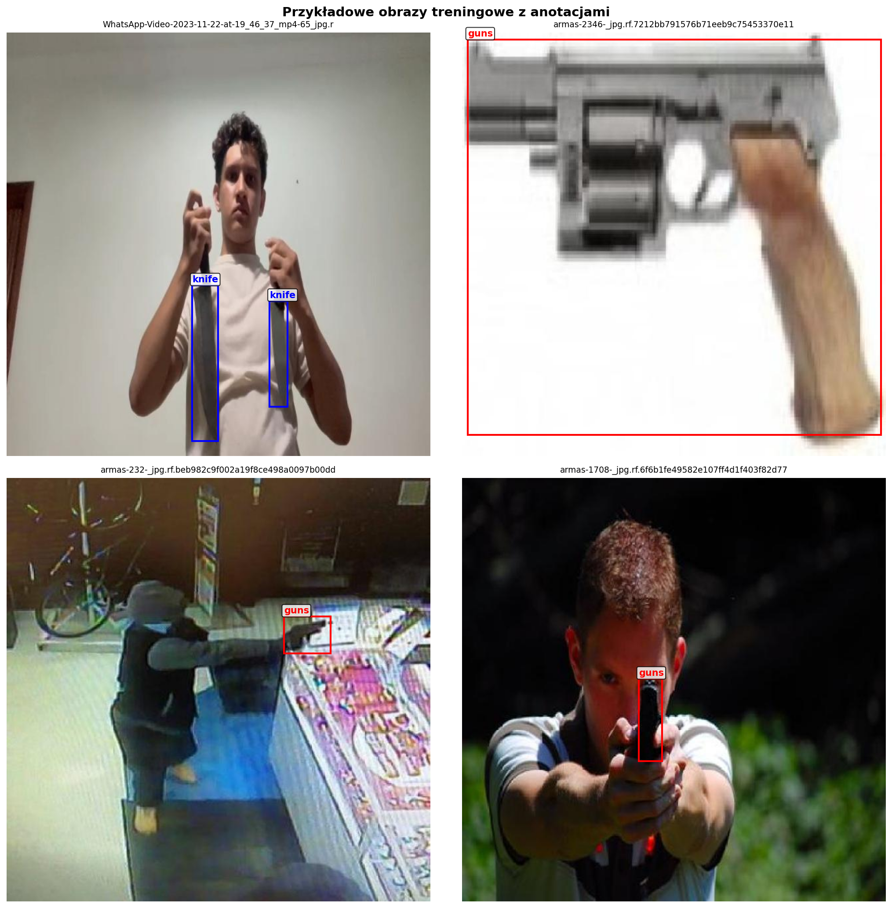
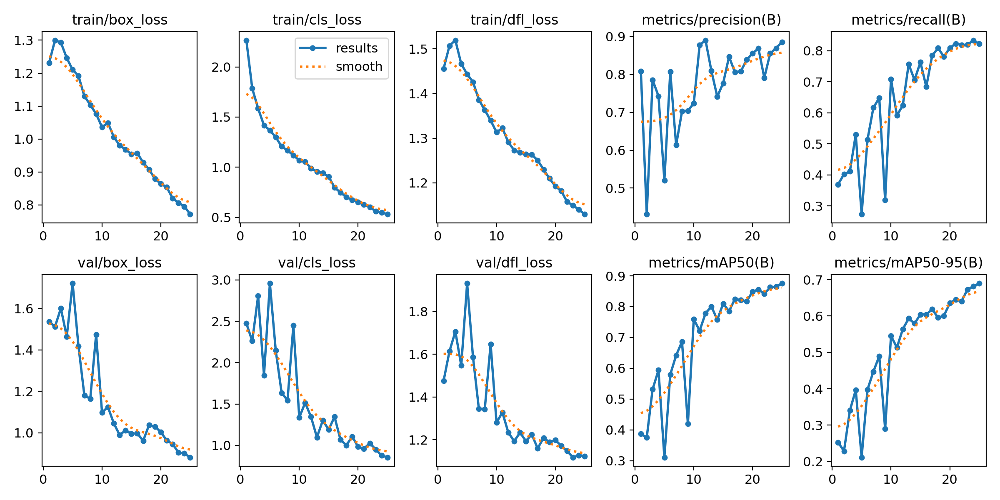
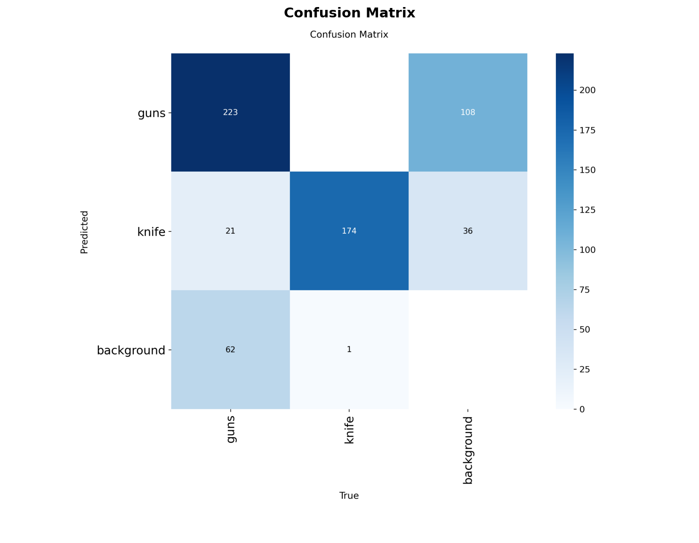

# Co dostarczyc (zrzuty ekranu) (1/2)

> **Uwaga:** dwa slajdy z listą screenshotów!

## Screenshot 1: Konfiguracja datasetu

- Widoczna struktura katalogow, `data.yaml`, przykladowe anotacje

## Screenshot 2: Logi treningowe

- Widoczne: krzywe loss, metryki (precision, recall, mAP)
- Lub `results.png` wygenerowany przez YOLO

---

# Co dostarczyc (zrzuty ekranu) (2/2)

## Screenshot 3: Wyniki ewaluacji

- Confusion matrix lub metryki `model.val()`
- mAP50 i mAP50-95

## Screenshot 4: Inferencja na nowych zdjeciach

- Minimum 4 zdjecia: bron - nie bron
- Widoczne bounding boxy (lub maski segmentacji) z confidence score

